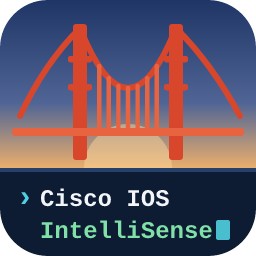
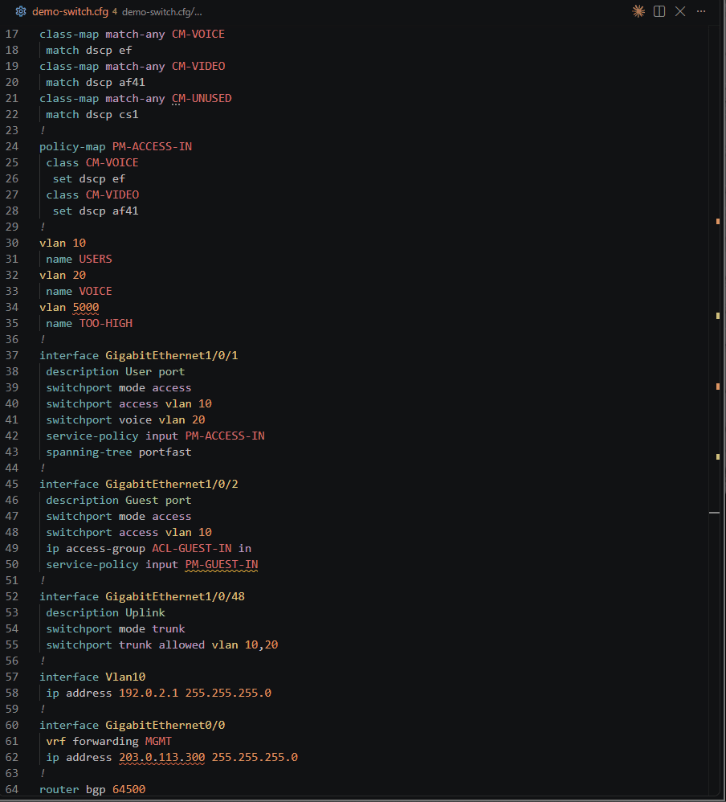
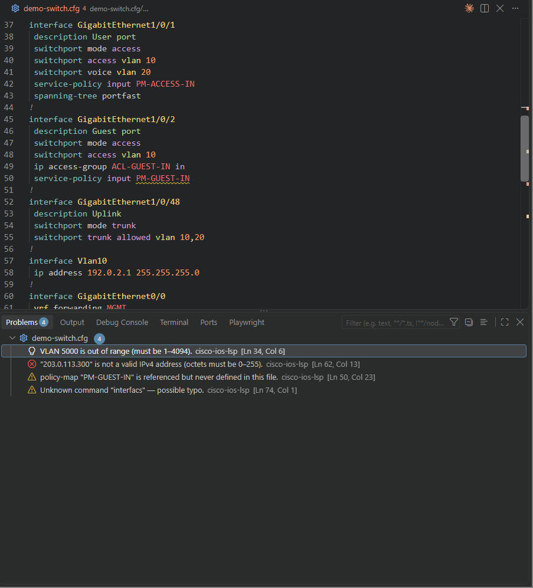
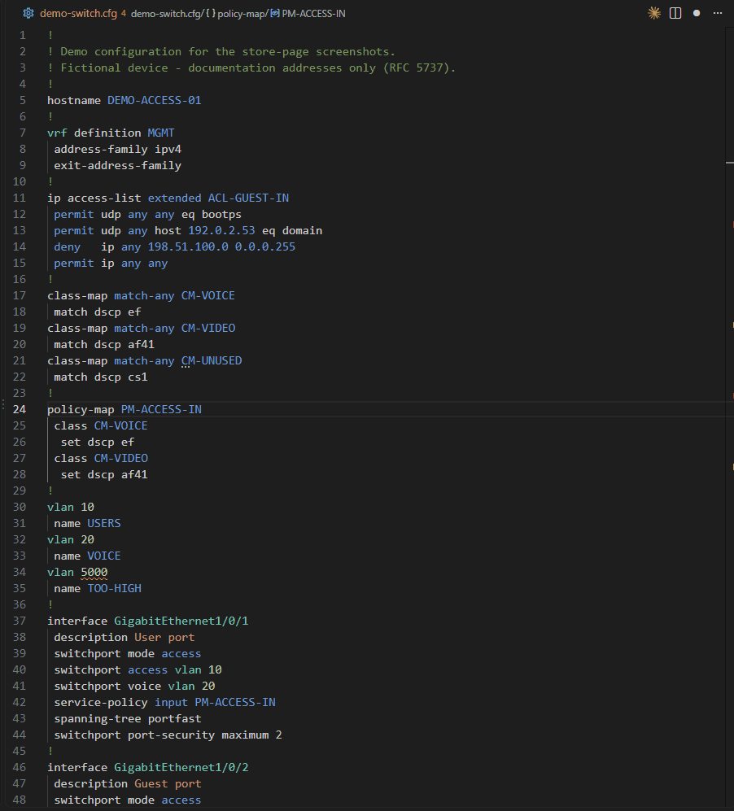

<p align="center">
  
</p>

<h1 align="center">Cisco IOS/IOS-XE IntelliSense</h1>

<p align="center">
  Editor support for Cisco IOS / IOS-XE configuration files in VS Code:<br>
  completions, hover docs, diagnostics, go-to-definition, rename and format on save.
</p>

<p align="center">
  <a href="https://marketplace.visualstudio.com/items?itemName=Aswertus.cisco-ios-lsp"></a>
  <a href="https://open-vsx.org/extension/Aswertus/cisco-ios-lsp"></a>
  <a href="https://github.com/Aswertus/cisco-lsp/releases/latest"></a>
  <a href="LICENSE"></a>
</p>



## Why

Network configs are code, but they're usually edited as plain text. This extension brings the
everyday comforts of a programming-language editor to IOS / IOS-XE configs:

- **Built from Cisco's own command references.** About 1,600 commands, with syntax, a
  description and usage notes, extracted from the Catalyst 9500 (IOS-XE 17.15, 17.18, 26.x)
  and Catalyst 2960-X (IOS 15.2) command references ([coverage](COMMAND_COVERAGE.md)).
- **Runs entirely on your machine.** Configs never leave the editor. The only network request
  is an optional check for new versions.
- **Self-contained.** Highlighting, outline and all language features are bundled.

## Features

| Feature                                    | What you get                                                                                                                                                                                |
| ------------------------------------------ | ------------------------------------------------------------------------------------------------------------------------------------------------------------------------------------------- |
| **Completions**                            | Context-aware: suggestions follow the block you're in (`interface`, `router bgp`, `class-map`, `policy-map`, `line vty`, `vrf definition`, `vlan`, ...) or global config. Also after `no `. |
| **Hover docs**                             | Syntax, description and Cisco's usage notes for each command.                                                                                                                               |
| **Diagnostics**                            | Unknown or misspelled commands, invalid interface names, VLAN IDs outside 1–4094, malformed IPv4 addresses, inconsistent indentation. Banner text and certificate data are never flagged.   |
| **Cross-references**                       | Warns when a policy-map, class-map, ACL, route-map, prefix-list or VRF is used but not defined, and hints when one is defined but never used.                                               |
| **Go to definition / references / rename** | F12, Shift+F12 and F2 on those object names, across every place they're applied.                                                                                                            |
| **Format on save**                         | Fixes exactly the indentation problems the checks report, nothing else.                                                                                                                     |
| **Template placeholders**                  | `<NAME>`, `$VAR`, Jinja and fill characters like `VlanXX` or `10.10.X.1` are highlighted as a whole, explained on hover, and never raise false warnings.                                    |
| **Folding, outline, breadcrumbs**          | Every block folds; the outline (opt-in) shows interfaces, VRFs, BGP, class-maps and policy-maps.                                                                                            |

|                                Diagnostics                                 |                              Rename                              |
| :------------------------------------------------------------------------: | :--------------------------------------------------------------: |
|  |  |

## Install

- **VS Code:** search for **Cisco IOS/IOS-XE IntelliSense** in the Extensions view, or install
  it from the [Marketplace](https://marketplace.visualstudio.com/items?itemName=Aswertus.cisco-ios-lsp).
- **VSCodium and other Open VSX editors:** install it from
  [Open VSX](https://open-vsx.org/extension/Aswertus/cisco-ios-lsp).
- **Offline:** download `cisco-ios-lsp-<version>.vsix` from the
  [latest release](https://github.com/Aswertus/cisco-lsp/releases/latest), then
  **Extensions → ⋯ → Install from VSIX…** (or `code --install-extension <file>.vsix`).

Store installs update automatically. A `.vsix` install doesn't; the extension tells you on
startup when a newer release exists (setting `cisco-ios-lsp.checkForUpdates`). Install the
new `.vsix` the same way, and your settings are kept.

## Usage

### File associations

Files ending in `.cfg`, `.ios`, `.cisco` and `.config` open as **Cisco Config**
automatically. For other names, pick **Cisco Config** in the status-bar language picker, or
add an association to your `settings.json`:

```json
"files.associations": {
  "*.conf": "cisco"
}
```

### Settings

| Setting                                           | Default      | What it does                                                                                                    |
| ------------------------------------------------- | ------------ | --------------------------------------------------------------------------------------------------------------- |
| `cisco-ios-lsp.diagnostics.unknownCommands`       | `warning`    | Report commands not in the loaded Cisco command references as `warning`, `information`, or `off`.               |
| `cisco-ios-lsp.diagnostics.ignoredCommands`       | `[]`         | Commands never reported as unknown, e.g. `["platform qos"]` (whole leading words, any case).                    |
| `cisco-ios-lsp.diagnostics.unusedObjects`         | `true`       | Hint when a class-map, policy-map, ACL, route-map, prefix-list or VRF is defined but never used.                |
| `cisco-ios-lsp.diagnostics.indentation`           | `true`       | Report indentation problems (format on save still fixes them).                                                  |
| `cisco-ios-lsp.outline.showSymbolsInOutlinePanel` | `false`      | Show the config structure in the Outline panel and breadcrumbs.                                                 |
| `cisco-ios-lsp.outline.symbolsList`               | all on       | Choose which kinds of blocks appear in the outline.                                                             |
| `cisco-ios-lsp.placeholders.style`                | `background` | How template placeholders are highlighted: `background`, `underline`, `italic`, `backgroundUnderline` or `off`. |
| `cisco-ios-lsp.placeholders.fillCharacters`       | `X`          | Characters that stand for "fill in later", e.g. `XN` for `VlanXX` and `10.10.N.1`.                              |
| `cisco-ios-lsp.checkForUpdates`                   | `true`       | For `.vsix` installs: check GitHub Releases for a newer version on startup.                                     |
| `cisco-ios-lsp.experimental.autoIndent`           | `false`      | Indent the next line after a block-opening command such as `interface X`.                                       |

Format on save uses VS Code's own `editor.formatOnSave` setting and is on by default for
Cisco config files. Run it manually with **Format Document** (Shift+Alt+F).

### Outline panel

With `cisco-ios-lsp.outline.showSymbolsInOutlinePanel` enabled, the Outline view and
breadcrumbs show the config structure. Each entry spans its whole block, so breadcrumbs and
sticky scroll follow the block your cursor is in:

- prompt commands (`hostname#`, `hostname>`)
- VRFs (`vrf definition <name>`, `ip vrf <name>`) with their address families
- BGP (`router bgp <asn>`, `address-family ...`)
- `class-map` / `policy-map` blocks
- `interface` blocks and sub-interfaces (e.g. `GigabitEthernet0/1.10`)

Use `cisco-ios-lsp.outline.symbolsList` to toggle individual categories.

### Coexisting with `Y-Ysss.cisco-config-highlight`

Syntax highlighting and the outline are adapted from
[`Y-Ysss.cisco-config-highlight`](https://marketplace.visualstudio.com/items?itemName=Y-Ysss.cisco-config-highlight)
(MIT licensed, see [THIRD_PARTY_NOTICES.md](THIRD_PARTY_NOTICES.md)). Both extensions use
the same `cisco` language ID and `source.cisco` scopes, so themes and
`editor.tokenColorCustomizations` render the same with either grammar, and it's safe to have
both installed.

VS Code has no setting to choose between two grammars for one language
([upstream issue](https://github.com/microsoft/vscode/issues/127917)). To decide which one
is used, disable one extension: disable `Y-Ysss.cisco-config-highlight` to use this
extension's grammar and all its features, or disable this one to fall back to the original
highlighting and outline only.

### Icon theme (Material Icon Theme)

[`PKief.material-icon-theme`](https://marketplace.visualstudio.com/items?itemName=PKief.material-icon-theme)
already shows its "settings" icon for `.config` files. To get the same icon for the other
extensions, add to your `settings.json`:

```json
"material-icon-theme.files.associations": {
  "*.cisco": "settings",
  "*.cfg": "settings",
  "*.ios": "settings"
}
```

## Feedback

[Open an issue](https://github.com/Aswertus/cisco-lsp/issues/new/choose) and pick the form
that fits: a bug, a false warning or missing command, support for another platform or
release, or an idea. In VS Code, **Help → Report Issue…** fills in the version details for
you.

**Issues are public:** include only the few lines needed, with hostnames, real IP addresses,
passwords/hashes, SNMP communities and keys replaced. Security problems go through
[private reporting](https://github.com/Aswertus/cisco-lsp/security/advisories/new) (see
[SECURITY.md](SECURITY.md)).

## Contributing

For building, testing and how releases work, see [CONTRIBUTING.md](CONTRIBUTING.md). Changes
per version are in the [CHANGELOG](CHANGELOG.md).

## License

[MIT](LICENSE). This project was developed with AI assistance (see
[CONTRIBUTING.md](CONTRIBUTING.md#ai-assisted-development)); review it before relying on it
in production network environments.

Cisco, IOS and Catalyst are trademarks of Cisco Systems, Inc. This is an independent project,
not affiliated with or endorsed by Cisco.
